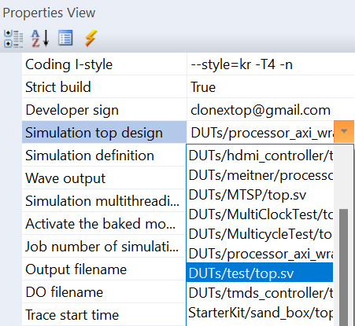

# Tutorial : Verilog Project

#### Quick approach) "Project creation :fa-arrow-right: build :fa-arrow-right: run" series of an example
```bash
>create_project v Test
*I: Create Verilog project : 'Test'(D:\Project\Profiles\Meitner\System\HDL\DUTs\Test)

Run '.eclipse' to open your project's IDE environment.

C:\Users\HyungKi>cd /d D:\Project\Profiles\Meitner\System\HDL\DUTs\Test

D:\Project\Profiles\Meitner\System\HDL\DUTs\Test>.eclipse
```
> After restarting TestDrive project, you can select the project you created under **"System/Simulation top design"** in the `Properties view`.
And you can compile manually by executing **"System/Build/Build H/W"** in the `Profile View`, or select **"Build Automation"** in the `Properties View` to trigger automatic compilation whenever the source code changes.

## 1. Project creation
The Verilog project is created based on the dependencies of the most recently executed TestDrive project.
When the command below is executed, the project is created at the location `%PROJECT%System/HDL/DUTs`.

**(basic Verilog project - for beginer)**
```bash
create_project v [Project_Name]
```
Or
**(bared Verilog project - for expert)**
```bash
create_project v_bare [Project_Name]
```
Or
**(Verigen Verilog project - for hyper-expert :)**
```bash
create_project verigen [Project_Name]
```

## 2. Project select and build
Project builds can only be performed via TestDrive; the process requires selecting "Simulation top design" and then executing the build.
To do this, restart TestDrive and make the selection as shown below.


If you also set `Build Automation` to 'True', the project source will be compiled whenever it is modified.
To build manually, select **"System/Build/Build H/W"** in the `Profile View`.

For further details on settings, please refer to Chapters 8 through 13 of the [System Manager Document](?Document_SystemManager.md).

### [:fa-arrow-left: Back](?top.md)
