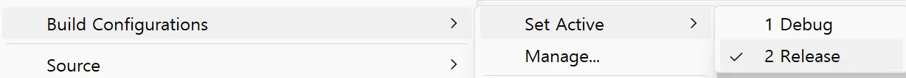
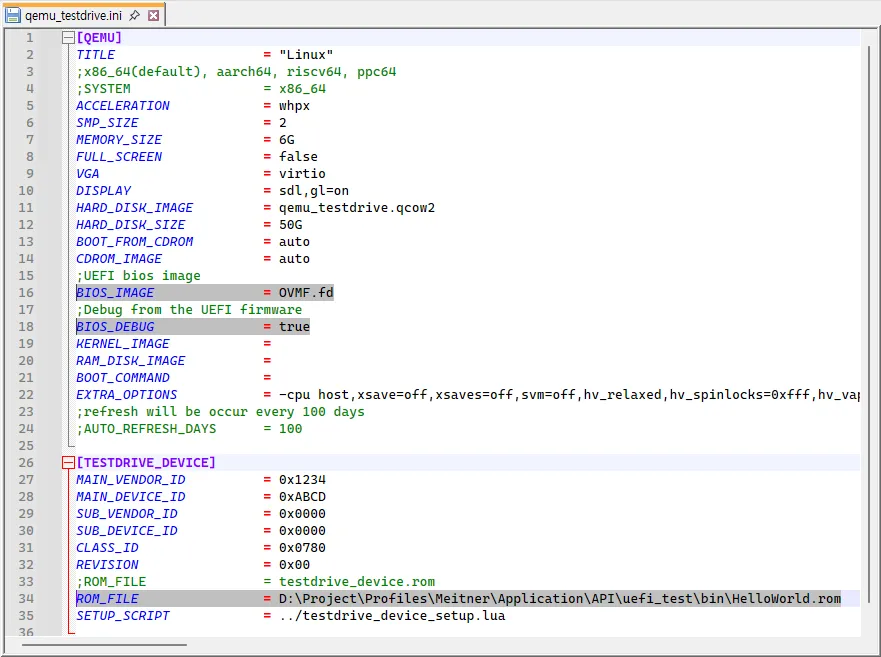
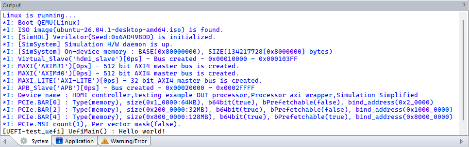

# Tutorial : Firmware(UEFI) Project

UEFI(Unified Extensible Firmware Interface) is an interface standard for controlling various devices, applicable either before or after the installation of an operating system on a PC.
* [UEFI Interfaces](https://uefi.org/uefi)
	* [Specification documents](https://uefi.org/specifications)
		* [UEFI 2.11](https://uefi.org/specs/UEFI/2.11/)

You can use [EDKII](https://github.com/tianocore/edk2) following wrapper tool to build UEFI project, and `TestDrive Profiling Master` integrates with both the Eclipse-IDE and [QEMU environments](?tutorial_qemu.md) to assist you in conducting tests within a virtual OS environment.

```bash
>edk2

EDK2 manager
Usage: edk2  [--help] command [-a TARGETARCH] [-b BUILDTARGET] [-p PLATFORMFILE] [-m MODULEFILE]

      --help                display this help and exit
  command                   EDK2 command
                            install : force to install EDK2
                            update  : check for update of EDK2
                            build   : build project
                            clean   : clean project
                            dump    : Dump ROM(-m option) image's header
  -a TARGETARCH             Target architecture (default:X64)
                            ARCHS is one of list: IA32, X64, AARCH64, RISCV64
  -b BUILDTARGET            Build Target (default:RELEASE)
  -p PLATFORMFILE           platform file
  -m MODULEFILE             module file
```
### 1. EDKII installation

You can explicitly install the EDKII tools using the command below. However, **this step is optional**, as the tools are automatically checked for and installed during the initial build process. If the build fails due to an improper tool installation, you can use this command to reinstall the tools.

```bash
>edk2 install
```
And you can check new updates. This process may take up to approximately 15 minutes.
```bash
>edk2 update
```
The EDKII tool's installation target folder is `%TESTDRIVE_PROFILE%Common/bin/edk2`.

### 2. Create new UEFI project & Do build

Using the [create_project](?util_create_project.md) utility, you can create a basic UEFI project as follows:
```bash
>create_project uefi "test_uefi"
*I: Create UEFI firmware project : 'test_uefi'

Run '.eclipse' to open your project's IDE environment.
```

And now you can build with `make` command.
```bash
>cd test_uefi
>make

......

Build end time: 11:03:06, Oct.18 2026
Build total time: 00:00:14

*I: Output ROM file : ./bin/HelloWorld.rom
Image 1 -- Offset 0x0
  ROM header contents
    Signature              0xAA55
    PCIR offset            0x001C
    Signature               PCIR
    Vendor ID               0x1234
    Device ID               0xABCD
    Length                  0x001C
    Revision                0x0003
    DeviceListOffset        0x00
    Class Code              0x000000
    Image size              0xE00
    Code revision:          0x0000
    MaxRuntimeImageLength   0x00
    ConfigUtilityCodeHeaderOffset 0x00
    DMTFCLPEntryPointOffset 0x00
    Indicator               0x80   (last image)
    Code type               0x03   (EFI image)
  EFI ROM header contents
    EFI Signature          0x0EF1
    Compression Type       0x0001 (compressed)
    Machine type           0x8664 (X64)
    Subsystem              0x000B (EFI boot service driver)
    EFI image offset       0x0038 (@0x38)
```
Final compressed UEFI rom file is located at `bin/HelloWorld.rom`.
Default build target is `DEBUG`, and you can build the `RELEASE` target as below.
```bash
>make BUILD_TARGET=RELEASE
```

You can follow the same process for the Eclipse-IDE environment by executing `.eclipse.bat`.


If you want to change build configuration to `RELEASE`, select `Release` on context menu, and press `CTRL+B` key to build.


### 3. Simulation on QEMU
First, check the [QEMU project for TestDrive](?tutorial_qemu.md) and create your own project.
At this point, you must specify the `UEFI system bios`(OVMF.fd:`%TESTDRIVE_PROFILE%common/bin/qemu/share/`), enable `BIOS_DEBUG`, and select the `UEFI driver`(ROM_FILE) you have just built, as shown below.



Then, when you run QEMU in the TestDrive environment, you will be able to see the `UefiMain() : Hello world!` debug output.



### [:fa-arrow-left: Back](?top.md)
